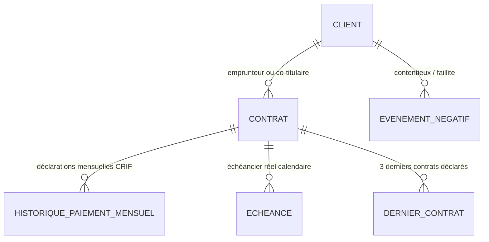

# Guide Complet : Calcul du Score de Solvabilité et Modèle d'Historique BIC CECAM

Ce document détaille le fonctionnement mathématique et technique du moteur de scoring de la solution BIC CECAM, le modèle de données de l'historique de crédit, et les algorithmes appliqués selon que le client dispose ou non d'un historique de remboursement.

---

## 1. Modèle de Données de l'Historique de Crédit

Le système BIC gère deux sources d'historique complémentaires :

### A. Modèle institutionnel (base interne & déclarations CRIF)
Enregistré lors du cycle de vie des prêts accordés ou importés :

1. **`Client`** :
   - `dateAdhesion` : date d'entrée comme sociétaire à la CECAM (*« Membre depuis le »*).
   - `dateNaissance` : détermine la tranche d'âge et la maturité financière.
   - `codeClientEtablissement` : numéro de membre sociétaire / livret CECAM.

2. **`Contrat`** :
   - `phaseDemande` : `DEMANDE_EN_COURS`, `ACTIF`, `FERME`, `REFUSE`, `ABANDONNE`.
   - `roleClient` : `TITULAIRE`, `CO_TITULAIRE` ou `GARANT` (les contrats où le client est garant ne sont pas comptés comme ses dettes).
   - `montantFinance`, `devise`, `typeContrat`, `typeCredit` (RFR, PRO, LVM, CIM, GCV).

3. **`HistoriquePaiementMensuel`** (Format CRIF / Centrale des Risques) :
   - `mois` : premier jour du mois calendaire observé (ex: `2025-01-01`).
   - `statut` : statut standardisé (`0` = à temps, `1-29`, `30-59`, `60-89`, `90-179`, `180+`, `IMPAYE`).
   - `joursDeRetard` : nombre exact de jours de retard constatés dans le mois.
   - `nombreEcheancesImpayees` : nombre de mensualités en souffrance.

4. **`Echeance`** :
   - `dateEcheance` : date limite d'exigibilité de la traite.
   - `montantTotal` : montant en principal + intérêts.
   - `datePaiementEffectif` : date à laquelle le sociétaire a réglé.
   - Calcul du retard en jours à la date de référence :
     $$\text{joursDeRetard} = \max(0, \text{dateRef} - \text{dateEcheance})$$

5. **`EvenementNegatif`** :
   - Incidents formels actifs (contentieux judiciaire, interdiction bancaire, protêt de chèque, redressement).

---

### B. Modèle déclaré sur la demande (`DernierContrat`)
Saisi par l'agent de crédit lors de la création d'une nouvelle demande (section *« Historique des 3 derniers contrats »*) :
- `typeCredit` : RFR (2.75%), PRO (3.5%), LVM (2.75%), CIM (2.75%), GCV (3%).
- `montant` : capital emprunté.
- `dateOctroi` & `datePrevueRemboursement`.
- `statut` :
  - **`ANTICIPATION`** : remboursé avant la date d'échéance.
  - **`A_TEMPS`** / **`NORMAL`** : remboursé sans aucun retard.
  - **`EN_RETARD`** : retard de paiement constaté.
  - **`NON_REMBOURSE`** : crédit en défaut ou impayé.
- L'historique résumé saisi dans le formulaire provient du dossier CECAM : l'interface ne demande pas de justificatif ni de niveau de preuve manuel. Il reste un résumé de contrat, pas un échéancier mensuel détaillé.
- `joursRetard` & `dateRemboursement` : calculés à partir des dates réelles (aucun jour arbitraire inventé).

---

## 2. Échelle de Score et Catégories de Risque

Le score est étalonné sur une plage de **300 à 850 points**, alignée sur les standards internationaux (FICO / Bureau) et projetée sur la grille de risque :

| Classe | Intervalle Score | Catégorie de Risque | Couleur indicative | Décision recommandée |
|:---:|:---:|---|:---:|---|
| **A** | **530 – 850** | **Risque très faible** | Vert pistache | Octroi très favorable, conditions optimales (≥ 12 échéances vérifiées) |
| **B** | **500 – 529** | **Risque faible** | Jaune moutarde | Octroi standard favorable (≥ 6 échéances vérifiées, arriéré en cours plafonné ici) |
| **C** | **460 – 499** | **Risque moyen** | Jaune Or | Octroi sous conditions (< 6 échéances vérifiées ou déclaratif seul) |
| **D** | **400 – 459** | **Risque élevé** | Orange citrouille | Vigilance accrue, garantie renforcée requise |
| **E** | **300 – 399** | **Risque très élevé** | Rouge Vif | Refus recommandé ou restructuration nécessaire (défaut ou contentieux) |

---

## 3. Plafonds de Décision et Maturité de l'Historique (P0/P1)

Le moteur applique des **plafonds de sécurité** selon les observations de paiement réelles, la capacité disponible et les incidents recensés. Un historique résumé du dossier CECAM n'est pas pénalisé par un plafond de preuve, mais sa faible quantité d'observations limite la confiance.

| Règle de risque | Plafond maximal | Classe résultante | Justification métier |
|---|:---:|:---:|---|
| **Moins de 6 observations détaillées récentes** | **499** | **C** | Recul insuffisant pour juger de la régularité sur la durée |
| **De 6 à 11 observations détaillées récentes** | **529** | **B** | Historique intermédiaire, classe A réservée aux historiques matures |
| **Historique résumé du dossier CECAM** | Aucun plafond fondé sur la preuve seule | Selon le score calculé | Un résumé ne compte pas comme plusieurs échéances ; la confiance est réduite selon le nombre d'observations disponibles |
| **Pire retard sur 24 mois $\ge$ 90 jours** | **499** | **C** | Incident significatif récent excluant les notes favorables |
| **Pire retard sur 24 mois $\ge$ 60 jours** | **529** | **B** | Retard sérieux limitant la notation à la classe B |
| **Arriéré en cours $\ge$ 1 jour (hors grâce)** | **529** | **B** | Aucun emprunteur en retard actif ne peut être noté en classe A |
| **Moins de 50 % des facteurs renseignés** | **499** | **C** | Manque de visibilité budgétaire ou patrimoniale |
| **Événement négatif formel (contentieux actif)** | **399** | **E** | Risque avéré de défaut bancaire (levé après prescription de 3 à 5 ans) |
| **Charge sur 12 mois > 80 % du revenu annuel** | **499** | **C** | Surendettement avéré |
| **Charge sur 12 mois > 100 % du revenu annuel** | **459** | **D** | Insolvabilité financière structurelle |

---

## 3. Formule Générale de Calcul

Le moteur calcule les **points obtenus** et les **points disponibles** sur l'ensemble des piliers applicables, puis applique une renormalisation proportionnelle :

$$\text{Score Brut} = \text{ScoreBase} + \text{EchellePoints} \times \left( \frac{\sum \text{Points Gagnés}}{\sum \text{Points Disponibles}} \right) + \text{Bonus} - \text{Malus}$$

Avec les constantes du moteur :
- $\text{ScoreBase} = 300$
- $\text{ScoreMax} = 850$
- $\text{EchellePoints} = 550$

Le score final est ensuite borné par les **plafonds de sécurité** :
$$\text{Score Final} = \min\left(850, \; \max(300, \; \min(\text{Score Brut}, \; \text{Plafond Minimal}))\right)$$

Le plafond lié à la couverture de garantie fait partie du calcul du score final : moins de 50 % plafonne à 459, et de 50 % à moins de 100 % plafonne à 499.

---

## 4. Calcul du Score AVEC Historique Réel

Ce cas s'applique dès que le client possède au moins un contrat décaissé en base (`PhaseDemande.ACTIF` ou `PhaseDemande.FERME`).

### A. Pilier Comportement de paiement (290 points)
Le moteur agrège l'ensemble des mensualités `HistoriquePaiementMensuel` et des `Echeance` échues.

#### 1. Pondération par ancienneté $W_{\text{date}}$
Une mensualité récente a plus de valeur prédictive qu'une mensualité ancienne :
- Mois $\le 12$ mois : **poids 1.00**
- Mois $13$ à $36$ mois : **poids 0.60**
- Mois $> 36$ mois : **poids 0.30**

#### 2. Qualité du paiement $Q(\text{retard})$ avec tolérance de grâce
Le moteur applique une **période de grâce de 5 jours** pour éviter de pénaliser des décalages techniques (week-ends, virements en cours) et une **décote graduelle continue** :
- **$\le 5$ jours de retard** (période de grâce) : $Q = 1.00$ ($100\%$ des points).
- **$6$ à $29$ jours** (retard court) : décroissance graduelle continue de $1.00$ à $0.72$.
- **$30$ à $179$ jours** (retard long) : décroissance linéaire de $0.15$ à $0.00$.
- **$\ge 180$ jours** (défaut avéré) : $Q = 0.00$.

#### 3. Facteur de confiance
Si le client a moins de 12 échéances sur les 36 derniers mois, un facteur de confiance modère la note :
$$\text{Confiance} = 0.50 + 0.50 \times \min\left(1.0, \; \frac{\text{Nb Échéances Récentes}}{12}\right)$$

$$\text{Points Paiement} = 290 \times \left(\frac{\sum W_i \cdot Q_i}{\sum W_i}\right) \times \text{Confiance}$$

### B. Arriérés en cours (60 points) — *Uniquement si crédits actifs en cours*
Le pilier n'est activé **que si le client possède au moins un crédit actif** en cours de remboursement (`!actifs.isEmpty()`). S'il n'a aucun crédit actif, ce pilier n'est pas évalué et ne pénalise pas le score.
- Retard actuel $\le 5$ jours : **60 points** (100%).
- Retard de $6$ à $29$ jours : part décroissante de $35\%$ à $20\%$ + **Plafond classe B (529 pts)**.
- Retard de $30$ à $59$ jours : part de $20\%$ + plafond à **499 pts** (Classe C).
- Retard de $60$ à $89$ jours : **0 point** + plafond à **459 pts** (Classe D).
- Retard $\ge 90$ jours : **0 point** + plafond à **399 pts** (Catégorie E).

### C. Prise en compte des 3 derniers contrats saisis
Afin d'**éviter le double comptage** avec l'historique déjà en base :
- Anticipation déclarée : bonus léger de **+10 points** (plafonné à +20 pts dans `ScoreProperties`).
- Retard déclaré : malus de **-10 points** (si historique réel existant) ou **-15 points** (sans historique).
- Les contrats résumés issus du dossier CECAM ne sont pas considérés comme des échéances détaillées et ne lèvent pas les plafonds fondés sur le nombre d'observations mensuelles réelles.

---

## 5. Calcul du Score SANS Historique Réel (Nouveau Client)

Quand un client n'a aucun emprunt antérieur dans la base de données (`empruntsDecaisses.isEmpty()`), deux situations sont gérées :

### Cas 5.A : Le nouveau client a renseigné ses 3 derniers contrats
Ces 3 contrats **tiennent lieu d'historique de remboursement de substitution** :

1. **Substitution dans le pilier Paiement (290 points)** :
   Chaque contrat déclaré devient une observation officielle :
   - **`ANTICIPATION`** : observation sans retard (qualité 1.00) + bonus d'anticipation (+10 pts par contrat, max +20 pts).
   - **`A_TEMPS` / `NORMAL`** : observation sans retard (qualité 1.00, 100% des points).
   - **`EN_RETARD`** : observation avec retard réel calculé + malus de retard (-15 pts).
   - **`NON_REMBOURSE`** : observation de retard critique $\rightarrow$ **Plafond strict à 399 pts** (Catégorie E).

2. **Confiance et maturité** :
   Les contrats résumés contribuent comme observations de substitution, mais un contrat résumé ne vaut pas plusieurs échéances. Le score applique un facteur de confiance selon le nombre d'observations récentes ; les plafonds de classe C/B selon le nombre d'observations portent sur l'historique détaillé réel, pas sur le nombre de lignes de résumé.

---

### Cas 5.B : Le nouveau client n'a aucun antécédent (primo-emprunteur)
Le client n'a ni historique en base, ni contrat déclaré dans la demande :

1. **Activation du Plafond sans historique** :
   Le score est borné à un **maximum de 499 points** (Catégorie C - Risque moyen au mieux). Un emprunteur sans antécédent ne peut pas être classé en risque très faible sans preuve de remboursement.

2. **Renormalisation proportionnelle sans pénalité** :
   Le pilier Paiement (290 pts) est retiré des *Points Disponibles*. Le score est calculé sur le ratio des autres piliers déclarés (Revenu, Budget, Garantie, etc.).

---

## 6. Détail des Piliers Complémentaires

### A. Capacité Budgétaire Mensuelle (30 points) — *Taux d'effort normalisé*
Plutôt qu'un simple ratio statique, le moteur calcule le **taux d'effort budgétaire mensuel** :
$$\text{Surplus Mensuel} = \text{Recettes Mensuelles} - \text{Dépenses Mensuelles}$$
$$\text{Charge Mensuelle Totale} = \text{Mensualité Demandée} + \sum \text{Mensualités Prêts Actifs}$$
$$\text{Taux d'Effort} = \frac{\text{Charge Mensuelle Totale}}{\text{Surplus Mensuel}}$$

- **Taux d'effort $\le 40\%$** : **30 points** (capacité optimale).
- **Taux d'effort entre $40\%$ et $80\%$** : décroissance linéaire de 30 à 10.5 points.
- **Taux d'effort entre $80\%$ et $100\%$** : décroissance de 10.5 à 0 point.
- **Taux d'effort $> 100\%$ ou surplus $\le 0$** : **0 point** et plafond budget critique à **399 pts** (Catégorie E).
- **Alerte de plausibilité** : si les recettes déclarées dépassent 15 000 000 Ar par mois pour un profil individuel, une alerte invite l'agent à vérifier s'il s'agit d'un chiffre d'affaires ou revenu annuel plutôt que mensuel.
- Lorsque seul le ratio budgétaire est disponible : $R \le 0\%$ déclenche le plafond critique à 399 pts ; $0\% < R \le 25\%$ déclenche le plafond à 459 pts ; au-delà, les points progressent jusqu'au maximum pour $R \ge 100\%$.

### B. Couverture de la demande intégrée au score global
Le score global reprend le score calculé à partir du comportement de remboursement et applique un plafond selon la couverture :
- Couverture **< 50 %** : plafond du score à **459** (classe D au mieux).
- Couverture de **50 % à < 100 %** : plafond à **499** (classe C au mieux).
- Couverture **≥ 100 %** : aucun plafond additionnel lié à la garantie.
- Couverture absente ou non calculable : aucun plafond fondé sur la garantie ; le rapport signale que ce facteur n'a pas pu être intégré.

Le ratio est calculé par rapport au montant total demandé avec intérêts. Un ratio stocké est privilégié ; à défaut, il est calculé à partir de la valeur de la garantie et du montant total. Le score numérique et sa classe sont ceux du score global, y compris dans la persistance et l'historique.

Le rapport détaille également la couverture pour l'analyse du dossier :
- **Niveau Forte ($\ge 150\%$)** : Couverture sécurisée.
- **Niveau Correcte ($120\% - 150\%$)** : Conforme aux normes prudentielles CECAM.
- **Niveau Juste ($100\% - 120\%$)** : Couverture acceptable, calcul du complément requis pour atteindre $120\%$.
- **Niveau Insuffisante ($< 100\%$)** : Non conforme, dérogation motivée requise, affichage automatique du manque de garantie pour $120\%$ et du capital maximal conseillé.

### C. Ancienneté Sociétaire CECAM (40 points)
Calculée à partir du champ *« Membre depuis le »* (`dateAdhesion`) :
$$\text{Ratio Ancienneté} = \min\left(1.0, \; \frac{\text{Mois d'Adhésion}}{48}\right)$$
$$\text{Points Ancienneté} = 40 \times \max(0.20, \; \text{Ratio Ancienneté})$$
Un sociétaire très récent conserve un socle d'accueil de **8 points minimum (20%)**, progressant jusqu'à **40 points pleins à 4 ans d'adhésion**.

### D. Profil Âge du Membre (25 points)
Calculé à partir de la date de naissance :
- **26 à 58 ans** : **25 points pleins** (maturité économique et stabilité professionnelle).
- **21 à 25 ans** ou **59 à 68 ans** : **18 points**.
- **18 à 20 ans** : **12 points**.
- Autres âges : **8 points**.

### E. Type de Crédit Demandé (15 points)
- **RFR** (Crédit agricole / fonds de roulement) & **GCV** (Grenier Commun Villageois) : **15 points** (filières historiques sécurisées par récoltes).
- **PRO**, **LVM**, **CIM** : **12 points**.

---

## 7. Plafonds de Sécurité Imposés

Lorsqu'un risque majeur est détecté, le score est plafonné à la valeur la plus restrictive, indépendamment des autres points gagnés :

| Règle de risque | Plafond Maximum | Classe Maximale |
|---|:---:|:---:|
| Événement négatif formel (contentieux, chèque impayé) | **399 pts** | **E (Très élevé)** |
| Retard actif en cours $\ge 90$ jours | **399 pts** | **E (Très élevé)** |
| Crédit antérieur déclaré non remboursé à terme | **399 pts** | **E (Très élevé)** |
| Recettes budgétaires mensuelles $\le$ dépenses | **399 pts** | **E (Très élevé)** |
| Retard actif en cours de 60 à 89 jours | **459 pts** | **D (Élevé)** |
| Charge annuelle sur 12 mois $>$ Revenu annuel | **459 pts** | **D (Élevé)** |
| Aucun historique de remboursement observé | **499 pts** | **C (Moyen)** |
| Retard actif en cours de 30 à 59 jours | **499 pts** | **C (Moyen)** |
| Couverture de garantie de 50 % à moins de 100 % | **499 pts** | **C (Moyen)** |
| Couverture de garantie inférieure à 50 % | **459 pts** | **D (Élevé)** |
| Capacité financière non vérifiable (ni revenu, ni budget) | **529 pts** | **B (Faible)** |

---

## 8. Persistance et Exploitation

- Lors de la génération d'un rapport (`/demande/rapport/:contratId`), le score global calculé (`scoreValeur`) et sa catégorie (`scoreCategorie`) sont enregistrés sur l'entité `Contrat`. Si le recalcul devient impossible, les anciennes valeurs sauvegardées sont effacées afin de ne pas afficher un score périmé.
- La page [`Historique des rapports`](file:///c:/Users/ambin/Music/BIC/bic-frontend/src/pages/HistoriqueRapportsPage.tsx) permet de filtrer les dossiers par note et niveau de risque (badges colorés), par marge de montant en Ariary (`Ar`), par type de prêt et par période.
