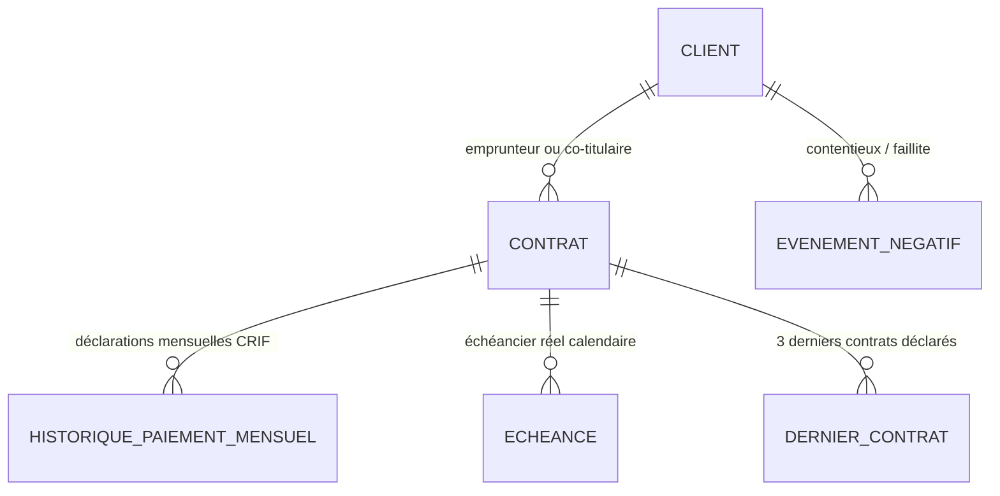

# Guide Complet : Calcul du Score de Solvabilité et Modèle d'Historique BIC CECAM

Ce document détaille le fonctionnement mathématique et technique du moteur de scoring de la solution BIC CECAM, le modèle de données de l'historique de crédit, et les algorithmes appliqués selon que le client dispose ou non d'un historique de remboursement.

---

## 1. Modèle de Données de l'Historique de Crédit

Le système BIC gère deux sources d'historique complémentaires :

### A. Modèle institutionnel (base interne & déclarations CRIF)
Enregistré lors du cycle de vie des prêts accordés ou importés :

1. **`Client`** :
   - `dateAdhesion` : date d'entrée comme sociétaire à la CECAM (*« Membre depuis le »*).
   - `dateNaissance` : détermine la tranche d'âge et la maturité financière.
   - `codeClientEtablissement` : numéro de membre sociétaire / livret CECAM.

2. **`Contrat`** :
   - `phaseDemande` : `DEMANDE_EN_COURS`, `ACTIF`, `FERME`, `REFUSE`, `ABANDONNE`.
   - `roleClient` : `TITULAIRE`, `CO_TITULAIRE` ou `GARANT` (les contrats où le client est garant ne sont pas comptés comme ses dettes).
   - `montantFinance`, `devise`, `typeContrat`, `typeCredit` (RFR, PRO, LVM, CIM, GCV).

3. **`HistoriquePaiementMensuel`** (Format CRIF / Centrale des Risques) :
   - `mois` : premier jour du mois calendaire observé (ex: `2025-01-01`).
   - `statut` : statut standardisé (`0` = à temps, `1-29`, `30-59`, `60-89`, `90-179`, `180+`, `IMPAYE`).
   - `joursDeRetard` : nombre exact de jours de retard constatés dans le mois.
   - `nombreEcheancesImpayees` : nombre de mensualités en souffrance.

4. **`Echeance`** :
   - `dateEcheance` : date limite d'exigibilité de la traite.
   - `montantTotal` : montant en principal + intérêts.
   - `datePaiementEffectif` : date à laquelle le sociétaire a réglé.
   - Calcul du retard en jours à la date de référence :
     $$\text{joursDeRetard} = \max(0, \text{dateRef} - \text{dateEcheance})$$

5. **`EvenementNegatif`** :
   - Incidents formels actifs (contentieux judiciaire, interdiction bancaire, protêt de chèque, redressement).

---

### B. Modèle déclaré sur la demande (`DernierContrat`)
Saisi par l'agent de crédit lors de la création d'une nouvelle demande (section *« Historique des 3 derniers contrats »*) :
- `typeCredit` : RFR (2.75%), PRO (3.5%), LVM (2.75%), CIM (2.75%), GCV (3%).
- `montant` : capital emprunté.
- `dateOctroi` & `datePrevueRemboursement`.
- `statut` :
  - **`ANTICIPATION`** : remboursé avant la date d'échéance.
  - **`A_TEMPS`** / **`NORMAL`** : remboursé sans aucun retard.
  - **`EN_RETARD`** : retard de paiement constaté.
  - **`NON_REMBOURSE`** : crédit en défaut ou impayé.
- `joursRetard` & `dateRemboursement`.

---

## 2. Échelle de Score et Catégories de Risque

Le score est étalonné sur une plage de **300 à 850 points**, alignée sur les standards internationaux (FICO / Bureau) et projetée sur la grille de risque :

| Classe | Intervalle Score | Catégorie de Risque | Couleur indicative | Décision recommandée |
|:---:|:---:|---|:---:|---|
| **A** | **530 – 850** | **Risque très faible** | Vert pistache | Octroi très favorable, conditions optimales |
| **B** | **500 – 529** | **Risque faible** | Jaune moutarde | Octroi standard favorable |
| **C** | **460 – 499** | **Risque moyen** | Jaune Or | Octroi sous conditions de garantie ou d'apport |
| **D** | **400 – 459** | **Risque élevé** | Orange citrouille | Vigilance accrue, garantie renforcée requise |
| **E** | **300 – 399** | **Risque très élevé** | Rouge Vif | Refus recommandé ou restructuration nécessaire |

---

## 3. Formule Générale de Calcul

Le moteur calcule les **points obtenus** et les **points disponibles** sur l'ensemble des piliers applicables, puis applique une renormalisation proportionnelle :

$$\text{Score Brut} = \text{ScoreBase} + \text{EchellePoints} \times \left( \frac{\sum \text{Points Gagnés}}{\sum \text{Points Disponibles}} \right) + \text{Bonus} - \text{Malus}$$

Avec les constantes du moteur :
- $\text{ScoreBase} = 300$
- $\text{ScoreMax} = 850$
- $\text{EchellePoints} = 550$

Le score final est ensuite borné par les **plafonds de sécurité** :
$$\text{Score Final} = \min\left(850, \; \max(300, \; \min(\text{Score Brut}, \; \text{Plafond Minimal}))\right)$$

---

## 4. Calcul du Score AVEC Historique Réel

Ce cas s'applique dès que le client possède au moins un contrat décaissé en base (`PhaseDemande.ACTIF` ou `PhaseDemande.FERME`).

### A. Pilier Comportement de paiement (290 points)
Le moteur agrège l'ensemble des mensualités `HistoriquePaiementMensuel` et des `Echeance` échues.

#### 1. Pondération par ancienneté $W_{\text{date}}$
Une mensualité récente a plus de valeur prédictive qu'une mensualité ancienne :
- Mois $\le 12$ mois : **poids 1.00**
- Mois $13$ à $36$ mois : **poids 0.60**
- Mois $> 36$ mois : **poids 0.30**

#### 2. Qualité du paiement $Q(\text{retard})$
- **0 jour de retard** : $Q = 1.00$ ($100\%$ des points).
- **1 à 29 jours** (retard court) : $Q = 0.55$.
- **30 à 180 jours** : décroissance linéaire de $0.15$ à $0.00$.
- **$> 180$ jours** (défaut) : $Q = 0.00$.

#### 3. Facteur de confiance
Si le client a moins de 12 échéances sur les 36 derniers mois, un facteur de confiance modère la note :
$$\text{Confiance} = 0.50 + 0.50 \times \min\left(1.0, \; \frac{\text{Nb Échéances Récentes}}{12}\right)$$

$$\text{Points Paiement} = 290 \times \left(\frac{\sum W_i \cdot Q_i}{\sum W_i}\right) \times \text{Confiance}$$

### B. Arriérés en cours (60 points)
Évalue si le client a un retard non régularisé sur un crédit actuellement actif :
- Retard actuel $= 0$ jour : **60 points** (100%).
- Retard de $1$ à $29$ jours : **15 points** (25%).
- Retard de $30$ à $59$ jours : **12 points** (20%) + plafond à **499 pts**.
- Retard $\ge 60$ jours : **0 point** + plafond à **459 pts**.
- Retard $\ge 90$ jours : **0 point** + plafond à **399 pts** (Catégorie E).

### C. Prise en compte des 3 derniers contrats saisis
Afin d'**éviter le double comptage** avec l'historique déjà en base :
- Anticipation déclarée : bonus léger de **+10 points**.
- Retard déclaré : malus de **-15 points**.
- Les contrats ne sont pas réinjectés comme des observations mensuelles afin de ne pas fausser les pondérations d'échéances réelles.

---

## 5. Calcul du Score SANS Historique Réel (Nouveau Client)

Quand un client n'a aucun emprunt antérieur dans la base de données (`empruntsDecaisses.isEmpty()`), deux situations sont gérées :

### Cas 5.A : Le nouveau client a renseigné ses 3 derniers contrats
Ces 3 contrats **tiennent lieu d'historique de remboursement complet** :

1. **Substitution dans le pilier Paiement (290 points)** :
   Chaque contrat déclaré devient une observation officielle :
   - **`ANTICIPATION`** : observation sans retard (qualité 1.00) + **Bonus immédiat de +20 pts** (plafonné à +30 pts au total).
   - **`A_TEMPS` / `NORMAL`** : observation sans retard (qualité 1.00, 100% des points).
   - **`EN_RETARD`** : observation avec retard $\ge 30$ jours + **Malus immédiat de -25 pts**.
   - **`NON_REMBOURSE`** : observation de retard critique (90 jours), retard courant fixé à 90 jours $\rightarrow$ **Plafond strict à 399 pts** (Catégorie E).

2. **Facteur de confiance maximal accordé** :
   Le moteur accorde une pleine valeur probante aux contrats saisis :
   $$\text{Facteur} = 0.90 + 0.05 \times \min(2, \; \text{Nb Contrats Saisis}) \quad \longrightarrow \quad \mathbf{0.95 \text{ à } 1.00}$$
   Un nouveau client ayant toujours remboursé ses prêts précédents peut ainsi capter **l'intégralité des 290 points de paiement**.

3. **Accès aux meilleures classes de score** :
   Le nouveau client peut être classé en catégorie **A (Risque très faible)** ou **B (Risque faible)** si ses revenus, son budget et sa garantie sont solides.

---

### Cas 5.B : Le nouveau client n'a aucun antécédent (primo-emprunteur)
Le client n'a ni historique en base, ni contrat déclaré dans la demande :

1. **Activation du Plafond sans historique** :
   Le score est borné à un **maximum de 499 points** (Catégorie C - Risque moyen au mieux). Un emprunteur sans aucun antécédent ne peut pas être classé en risque très faible sans preuve de remboursement.

2. **Renormalisation proportionnelle sans pénalité** :
   Le pilier Paiement (290 pts) est retiré des *Points Disponibles*. Le score est calculé sur le ratio des autres piliers déclarés :
   - Reste budgétaire (Revenus - Dépenses) : jusqu'à 30 pts.
   - Revenu annuel (Taux d'endettement & d'exposition) : jusqu'à 35 + 25 pts.
   - Couverture de la garantie : jusqu'à 30 pts.
   - Couverture du patrimoine : jusqu'à 30 pts.
   - Ancienneté sociétaire CECAM : jusqu'à 40 pts.
   - Profil âge sociétaire : jusqu'à 25 pts.
   - Type de crédit demandé : jusqu'à 15 pts.

3. **Condition de calculabilité** :
   Si le client ne fournit **aucun remboursement, aucun revenu, aucun budget, aucune garantie et aucun patrimoine**, le score renvoie :
   > *« Ce client vient d'être créé et ne possède ni historique de remboursement ni données de capacité. »*

---

## 6. Détail des Piliers Complémentaires

### A. Capacité Budgétaire Mensuelle (30 points)
Évaluée d'après le ratio de reste à vivre sur les dépenses :
$$R = \frac{\text{Recettes Totales} - \text{Dépenses Totales}}{\text{Dépenses Totales}} \times 100$$
- $R \le 0\%$ : 0 point + **Plafond critique à 399 pts** (recettes inférieures aux charges).
- $0\% < R \le 25\%$ : 0 à 5 points + **Plafond à 459 pts**.
- $25\% < R \le 50\%$ : 5 à 15 points.
- $50\% < R < 100\%$ : 15 à 22 points.
- $R \ge 100\%$ : **30 points pleins**.

### B. Couverture de la Garantie (30 points)
Ratio de couverture par rapport au capital et intérêts dus :
$$G = \frac{\text{Valeur Garantie Totale}}{\text{Montant Financé} \times (1 + \text{Taux Intérêt} \times \text{Durée})} \times 100$$
- $G < 100\%$ : 0 point + **Plafond à 420 pts** + **Alerte avec suggestion automatique d'un montant réduit pour atteindre 120%**.
- $100\% \le G \le 120\%$ : 0 à 8 points + plafond à 499 pts.
- $120\% < G \le 150\%$ : 8 à 16 points.
- $150\% < G \le 200\%$ : 16 à 24 points.
- $G > 200\%$ : **30 points pleins**.

### C. Ancienneté Sociétaire CECAM (40 points)
Calculée à partir du champ *« Membre depuis le »* (`dateAdhesion`) :
$$\text{Ratio Ancienneté} = \min\left(1.0, \; \frac{\text{Mois d'Adhésion}}{48}\right)$$
$$\text{Points Ancienneté} = 40 \times \max(0.20, \; \text{Ratio Ancienneté})$$
Un sociétaire très récent conserve un socle d'accueil de **8 points minimum (20%)**, progressant jusqu'à **40 points pleins à 4 ans d'adhésion**.

### D. Profil Âge du Membre (25 points)
Calculé à partir de la date de naissance :
- **26 à 58 ans** : **25 points pleins** (maturité économique et stabilité professionnelle).
- **21 à 25 ans** ou **59 à 68 ans** : **18 points**.
- **18 à 20 ans** : **12 points**.
- Autres âges : **8 points**.

### E. Type de Crédit Demandé (15 points)
- **RFR** (Crédit agricole / fonds de roulement) & **GCV** (Grenier Commun Villageois) : **15 points** (filières historiques sécurisées par récoltes).
- **PRO**, **LVM**, **CIM** : **12 points**.

---

## 7. Plafonds de Sécurité Imposés

Lorsqu'un risque majeur est détecté, le score est plafonné à la valeur la plus restrictive, indépendamment des autres points gagnés :

| Règle de risque | Plafond Maximum | Classe Maximale |
|---|:---:|:---:|
| Événement négatif formel (contentieux, chèque impayé) | **399 pts** | **E (Très élevé)** |
| Retard actif en cours $\ge 90$ jours | **399 pts** | **E (Très élevé)** |
| Crédit antérieur déclaré non remboursé à terme | **399 pts** | **E (Très élevé)** |
| Recettes budgétaires mensuelles $\le$ dépenses | **399 pts** | **E (Très élevé)** |
| Garantie inexistante (0 Ar) | **399 pts** | **E (Très élevé)** |
| Garantie $< 100\%$ du capital avec intérêts | **420 pts** | **D (Élevé)** |
| Retard actif en cours de 60 à 89 jours | **459 pts** | **D (Élevé)** |
| Charge annuelle sur 12 mois $>$ Revenu annuel | **459 pts** | **D (Élevé)** |
| Aucun historique de remboursement observé | **499 pts** | **C (Moyen)** |
| Retard actif en cours de 30 à 59 jours | **499 pts** | **C (Moyen)** |
| Garantie juste comprise entre 100% et 120% | **499 pts** | **C (Moyen)** |
| Capacité financière non vérifiable (ni revenu, ni budget) | **529 pts** | **B (Faible)** |

---

## 8. Persistance et Exploitation

- Lors de la génération d'un rapport (`/demande/rapport/:contratId`), le score calculé (`scoreValeur`) et sa classe (`scoreCategorie`) sont automatiquement enregistrés sur l'entité `Contrat`.
- La page [`Historique des rapports`](file:///c:/Users/ambin/Music/BIC/bic-frontend/src/pages/HistoriqueRapportsPage.tsx) permet de filtrer les dossiers par note et niveau de risque (badges colorés), par marge de montant en Ariary (`Ar`), par type de prêt et par période.
