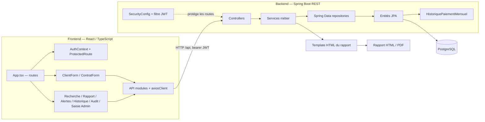

# Carte du code BIC

Carte d'architecture maintenue pour aider les développeurs et assistants IA à trouver les bons points d'entrée. Elle décrit les liens confirmés par l'organisation et les appels visibles dans le dépôt ; elle ne remplace pas la vérification du code source. Le graphe de symboles généré par Graphify se trouve dans `../graphify-out/`.

## Vue d'ensemble

## Parcours principaux

| Parcours | Points d'entrée et enchaînement |
|---|---|
| Connexion et session | `src/pages/LoginPage.tsx` → `src/api/authApi.ts` → `auth/AuthController` → `JwtUtil`, `JwtAuthenticationFilter`, `config/SecurityConfig` → `src/context/AuthContext.tsx` → `components/auth/ProtectedRoute.tsx` |
| Créer un client | Route `/demande/nouvelle/individu` dans `src/App.tsx` → `features/client/ClientForm.tsx` + `clientSchema.ts` → `api/clientApi.ts` → `client/ClientController` → `ClientService` → `ClientRepository` et entités client |
| Créer une demande | Route `/demande/nouvelle/contrat/:clientId` → `features/contrat/ContratForm.tsx` + `contratSchema.ts` → `api/contratApi.ts` → `contrat/ContratController` → `ContratService` → repositories et entités contrat/échéance |
| Consulter un rapport | Route `/demande/rapport/:contratId` → `pages/RapportPage.tsx` → `api/rapportApi.ts` → `rapport/RapportController` → `RapportService`, `ScoreService`, services calendrier/PDF → `resources/templates/rapport-solvabilite.html` |
| Fonctions transverses | Pages de recherche, rapports, alertes et audit → API frontend → contrôleurs `client`, `rapport` et `audit`; les alertes sont calculées depuis les contrats actifs et leurs échéances |

## Routes frontend

Les routes applicatives sont déclarées dans `bic-frontend/src/App.tsx`. `/login` est publique ; le reste passe par `ProtectedRoute`.

| Route | Page / formulaire |
|---|---|
| `/` | `HomeMenu` |
| `/demande/nouvelle/individu` | `ClientForm` |
| `/demande/nouvelle/contrat/:clientId` | `ContratForm` |
| `/demande/rapport/:contratId` | `RapportPage` |
| `/recherche/individu` | `RechercheIndividuPage` |
| `/demande/modifier` | `MiseAJourDemandePage` |
| `/alertes` | `AlertesPage` |
| `/rapports` | `HistoriqueRapportsPage` |
| `/audit` | `AuditPage` |
| `/admin` et `/admin/saisie-historique` | `SaisieHistoriquePage`, protégée par `AdminRoute` |

`axiosClient` prend `VITE_API_BASE_URL` ou utilise `http://localhost:8080/api` par défaut et ajoute le bearer token stocké côté navigateur.

## API backend repérées

| Contrôleur | Base de route | Responsabilité |
|---|---|---|
| `AuthController` | `/api/auth` | Connexion |
| `UtilisateurController` | `/api/utilisateurs` | Comptes utilisateurs |
| `ClientController` | `/api/clients` | Création, mise à jour, adresses et recherche client |
| `ContratController` | `/api/contrats` | Demandes, liste/recherche, historique admin et changement de phase |
| `EcheanceController` | `/api/echeances` | Échéances et paiements |
| `RapportController` | `/api/rapports/contrat/{contratId}` | Rapport JSON, HTML et PDF |
| `AlerteController` | `/api/alertes` | Alertes d'échéances en retard ou impayées |
| `AuditController` | `/api/audit` | Journal d'audit |

## Saisie et lecture de l'historique de crédit

Les pages `bic-frontend/src/pages/admin/ImportPage.tsx` et `SaisieHistoriquePage.tsx` sont réservées aux administrateurs. L'import CSV client déduplique par CIN ; la saisie d'historique envoie le formulaire vers `POST /api/contrats/historique`. Le service `ContratService` enregistre les champs source du contrat, les échéances exactes, les déclarations mensuelles, les garanties, le bien en leasing et les clients liés. La route `PUT /api/contrats/{id}/historique` remplace ces blocs lors d'une modification.

Les échéances datées (`Echeance`) restent distinctes des observations mensuelles CRIF (`HistoriquePaiementMensuel`). Le rapport privilégie les observations déclarées lorsqu'elles existent et conserve leur détail source ; il calcule un historique à partir des échéances seulement lorsque ces observations ne sont pas disponibles. Cette séparation évite d'inventer une date de paiement ou un échéancier exact à partir d'un relevé mensuel. `SituationFinanciereMensuelleService` agrège les échéanciers datés par mois, catégorie et devise ; un rapport sans dates et montants d'échéance exacts n'alimente pas ces totaux. `BucketRetard` partage les seuils 1–29, 30–59, 60–89, 90–119, 120–149, 150–179 et 180+ entre le score, les alertes et l'historique. `ContratLien.clientLie` relie maintenant un garant/co-emprunteur à son profil client quand son code CB est connu. Les contrats créés à partir de maintenant conservent aussi l'utilisateur déclarant ; les anciens contrats restent sans attribution si le rapport source ne l'indique pas.

Sur une base existante, appliquer une fois les migrations manuelles dans `bic-backend/src/main/resources/db/manual/` : `20261008_allow_partial_historical_contracts.sql`, `20261008_link_contract_clients.sql`, `20261008_add_contract_declaring_user.sql` et `20261009_add_data_provenance.sql`. Certains rapports ne donnent ni date de demande, ni montant financé, ni nombre d'échéances pour chaque contrat ancien. Les demandes actuelles gardent ces champs obligatoires dans leur DTO.

`OrigineDonnee` reste disponible pour la provenance des contrats saisis et historiques, affichée dans le détail de la demande et les contrats historiques du rapport. Le formulaire client, l'import CSV et le rapport ne demandent ni n'affichent plus une origine client. La colonne héritée `client.origine_donnee` est conservée pour compatibilité avec la base existante ; elle n'est plus alimentée par le DTO de création/modification client. La migration `20261009_add_data_provenance.sql` conserve les lignes existantes en `NON_RENSEIGNEE` au lieu de déduire leur source.

`RapportService.construire` enregistre aussi la consultation dans le journal d'audit : sa transaction doit donc rester inscriptible même si la lecture des données du rapport est majoritaire. La page de rapport distingue maintenant un contrat absent d'une erreur serveur au lieu d'afficher le même message pour toute erreur.

## Repères pour une question ciblée

- Formulaire et validation : commencer par le fichier de formulaire et son schéma Zod, puis suivre l'API appelée.
- Champ ou règle métier : rechercher le DTO et le service backend correspondants, puis confirmer l'entité et le mapping JPA.
- Rapport : commencer par `RapportController`, suivre `RapportService`, puis vérifier le DTO de réponse et le template HTML.
- Autorisation : vérifier `SecurityConfig`, le filtre JWT et les annotations `@PreAuthorize` du contrôleur.
- Configuration locale : `bic-backend/src/main/resources/application.yml`, `bic-frontend/vite.config.ts` et `bic-frontend/package.json`. Ne jamais recopier de valeurs sensibles dans cette documentation.

## Graphe Graphify et mise à jour

`../graphify-out/` contient le rapport lisible (`GRAPH_REPORT.md`), le graphe interrogeable (`graph.json`), le manifeste portable (`manifest.json`) et sa visualisation (`graph.html`). Le dernier rapport présent a été construit en mode code uniquement : 154 fichiers analysés, 948 nœuds et 2 160 liens répartis en 59 communautés. Ces chiffres sont ceux de cette extraction antérieure et le graphe généré n'a pas été actualisé pour les changements décrits ici : le CLI `graphify` et son gestionnaire `uv` n'étaient pas installés. Les scripts SQL manuels ne sont pas représentés dans le graphe. Les documents et images ne sont pas inclus, car leur extraction demanderait un backend de modèle ; le cahier des charges reste donc à consulter séparément.

Après avoir installé le CLI Graphify (`uv tool install graphifyy`), depuis la racine du dépôt, actualiser avec `graphify . --code-only`, puis `graphify cluster-only .`. Les caches et métadonnées locales sont ignorés par `.gitignore`; les fichiers `graph.json`, `GRAPH_REPORT.md`, `graph.html` et `manifest.json` restent partageables. Si l'architecture ou les routes ont changé, actualiser aussi cette carte Mermaid et vérifier les liens dans le code.
