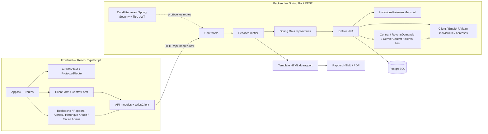

# Carte du code BIC

Carte d'architecture maintenue pour aider les développeurs et assistants IA à trouver les bons points d'entrée. Elle décrit les liens confirmés par l'organisation et les appels visibles dans le dépôt ; elle ne remplace pas la vérification du code source. Le graphe de symboles généré par Graphify se trouve dans `../graphify-out/`.

## Vue d'ensemble

## Parcours principaux

| Parcours | Points d'entrée et enchaînement |
|---|---|
| Connexion et session | `src/pages/LoginPage.tsx` → `src/api/authApi.ts` → `auth/AuthController` → `JwtUtil`, `JwtAuthenticationFilter`, `config/SecurityConfig` → `src/context/AuthContext.tsx` → `components/auth/ProtectedRoute.tsx` |
| Créer un client | Route `/demande/nouvelle/individu` dans `src/App.tsx` → `features/client/ClientForm.tsx` + `clientSchema.ts` → `api/clientApi.ts` → `client/ClientController` → `ClientService` → `ClientRepository` et entités client. Le formulaire enforce le Nom en majuscules, Prénom(s) et adresses en majuscule initiale automatique, Numéro membre CECAM (`codeClientEtablissement`), date d'adhésion ("Membre depuis le"), formatage du téléphone (`034 14 329 43`) et du CIN en lots de 3 (`108 111 089 921`), documents d'identification, emploi et affaire individuelle. Scroll automatique animé vers le premier champ erroné. |
| Créer une demande | Route `/demande/nouvelle/contrat/:clientId` → `features/contrat/ContratForm.tsx` + `contratSchema.ts` → `api/contratApi.ts` → `contrat/ContratController` → `ContratService` → repositories et entités contrat/échéance/dernierContrat. Ordre des sections : Données demande → Patrimoine → Capacité budgétaire (sans périodicité) → Historique 3 derniers contrats → Professions/revenus → Garantie. Valeurs par défaut : RFR (2.75%) et rôle TITULAIRE. Dropdown de statut pour les 3 derniers contrats (À temps, Anticipation, En retard, Normal, Non remboursé) avec type de crédit dédié. Suppression de la section Dépôts et crédits actifs. Auto-scroll animé en cas d'erreur. |
| Consulter un rapport | Route `/demande/rapport/:contratId` → `pages/RapportPage.tsx` → `api/rapportApi.ts` → `rapport/RapportController` → `RapportService`, `ScoreService` (calcul fiable pour nouveaux clients et avec historique sans double comptage, analyse âge sociétaire, ancienneté membre, ratio garantie, budget et bonus anticipation), `CalendrierService` → `resources/templates/rapport-solvabilite.html` (tableau détaillé de décomposition du score par composante, alerte et suggestion de baisse de montant si garantie < 100% pour couverture 120%, persistance de `scoreValeur` et `scoreCategorie` sur Contrat) |
| Historique des rapports | Route `/rapports` → `pages/HistoriqueRapportsPage.tsx` → `api/axiosClient.get('/contrats')` → `ContratController.lister` → `ContratService.listerTous` (trié par ID descendant pour afficher les derniers rapports générés en premier). Tableau enrichi avec colonne Score & Risque (badges colorés par niveau de risque A-E). Filtres avancés : marge de montant (min/max et boutons rapides <5M, 5M-20M, etc.), catégorie de score, type de crédit (RFR, PRO, etc.), période et recherche textuelle. Consultation directe et téléchargement PDF instantané. |
| Fonctions transverses | Pages de recherche, rapports, alertes et audit → API frontend → contrôleurs `client`, `rapport` et `audit`; les alertes sont calculées depuis les contrats actifs et leurs échéances |
| Soumettre une mise à jour | `pages/MiseAJourDemandePage.tsx` → `api/modificationContratApi.ts` → `ModificationContratController` → `ModificationContratService` → `ModificationContratDemandeRepository`; seuls les administrateurs peuvent approuver ou refuser |
| Gérer les utilisateurs | Route `/admin/utilisateurs` → `pages/admin/GestionUtilisateursPage.tsx` → `api/utilisateurApi.ts` → `auth/UtilisateurController` (CRUD complet) → `UtilisateurRepository`; création/modification/suppression/bascule actif réservées à l'admin, mot de passe haché par BCrypt, audit de chaque action, auto-suppression interdite |
| Importer des clients | `pages/admin/ImportPage.tsx` → `api/clientApi.ts` → `ClientController` → `ClientService.enregistrerOuRecuperer`; les doublons CIN sont comptés et chaque ligne invalide est signalée |

## Routes frontend

Les routes applicatives sont déclarées dans `bic-frontend/src/App.tsx`. `/login` est publique ; le reste passe par `ProtectedRoute`.

| Route | Page / formulaire |
|---|---|
| `/` | `HomeMenu` |
| `/demande/nouvelle/individu` | `ClientForm` |
| `/demande/nouvelle/contrat/:clientId` | `ContratForm` |
| `/demande/rapport/:contratId` | `RapportPage` |
| `/recherche/individu` | `RechercheIndividuPage` |
| `/demande/modifier` | `MiseAJourDemandePage` |
| `/alertes` | `AlertesPage` |
| `/rapports` | `HistoriqueRapportsPage` |
| `/audit` | `AuditPage` |
| `/admin/import` | `ImportPage`, protégée par `AdminRoute` |
| `/admin/demandes-modification` | `DemandesModificationPage`, protégée par `AdminRoute` et API admin |
| `/admin/utilisateurs` | `GestionUtilisateursPage`, protégée par `AdminRoute` — CRUD comptes agents/admin |
| `/admin/creer-agent` | `CreerAgentPage`, protégée par `AdminRoute` — formulaire de création d'un agent de crédit |
| `/admin/saisie-historique` | `SaisieHistoriquePage`, protégée par `AdminRoute` |
| `*` | Redirection vers `/` (catch-all 404) |

`axiosClient` prend `VITE_API_BASE_URL` ou utilise `http://localhost:8080/api` par défaut et ajoute le bearer token stocké côté navigateur.

## API backend repérées

| Contrôleur | Base de route | Responsabilité |
|---|---|---|
| `AuthController` | `/api/auth` | Connexion |
| `UtilisateurController` | `/api/utilisateurs` | CRUD complet des comptes (lister, créer, modifier, bascule actif, supprimer) — admin uniquement |
| `ClientController` | `/api/clients` | Création, mise à jour, adresses et recherche client |
| `ContratController` | `/api/contrats` | Demandes, évaluation des crédits actifs liés, liste/recherche, historique admin et modifications directes réservées à l'admin |
| `ModificationContratController` | `/api/demandes-modification` | Soumission agent, demandes personnelles, liste admin, approbation et refus |
| `EcheanceController` | `/api/echeances` | Échéances et paiements |
| `RapportController` | `/api/rapports/contrat/{contratId}` | Rapport JSON, HTML et PDF |
| `AlerteController` | `/api/alertes` | Alertes d'échéances en retard ou impayées |
| `AuditController` | `/api/audit` | Journal d'audit |

## Saisie et lecture de l'historique de crédit

Les pages `bic-frontend/src/pages/admin/ImportPage.tsx`, `DemandesModificationPage.tsx` et `SaisieHistoriquePage.tsx` sont réservées aux administrateurs. L'import CSV client déduplique par CIN, affecte la catégorie `0004` à l'individu et rapporte les erreurs par numéro de ligne sans arrêter les autres enregistrements ; son modèle CSV ne contient pas de faux client. Le code client local CECAM est facultatif. La saisie d'historique envoie le formulaire vers `POST /api/contrats/historique`. Le service `ContratService` enregistre les champs source du contrat, les échéances exactes, les déclarations mensuelles, les garanties, le bien en leasing et les clients liés. La route `PUT /api/contrats/{id}/historique` remplace ces blocs lors d'une modification.

Les échéances datées (`Echeance`) restent distinctes des observations mensuelles CRIF (`HistoriquePaiementMensuel`). Le rapport privilégie les observations déclarées lorsqu'elles existent et conserve leur détail source ; il calcule un historique à partir des échéances seulement lorsque ces observations ne sont pas disponibles. Le score suit la même priorité par contrat : observations mensuelles source exploitables, ou échéances datées si les observations mensuelles sont absentes ou entièrement non observables. Cette règle évite de compter deux fois une période couverte par les deux formes de données. La confiance du score compte les mois observés dans la fenêtre glissante de maturité, et un avertissement est ajouté si cette fenêtre est incomplète. Cette séparation évite d'inventer une date de paiement ou un échéancier exact à partir d'un relevé mensuel. `SituationFinanciereMensuelleService` agrège les échéanciers datés par mois, catégorie et devise ; les grilles Encours/Impayés et la synthèse des financements regroupent les montants par catégorie, établissement déclarant et devise, sans conversion. Les totaux globaux ne sont affichés que si tous les contrats partagent une devise renseignée. Les codes d'établissement absents s'affichent comme non renseignés. Un rapport sans dates et montants d'échéance exacts n'alimente pas les totaux monétaires. `BucketRetard` partage les seuils 1–29, 30–59, 60–89, 90–119, 120–149, 150–179 et 180+ entre le score, les alertes et l'historique ; les libellés inconnus ne sont plus présentés comme un paiement à temps. `ContratLien.clientLie` relie un garant/co-emprunteur à son profil client quand son code CB est connu. `ContratRepository.findPourClient` inclut les contrats détenus par le client et ceux où il est relié comme co-emprunteur ; le rapport, le score, la liste des contrats du client et ses alertes utilisent cette portée commune. `AffaireIndividuelle` est une donnée facultative du profil individuel, distincte de l'adresse personnelle ; elle contient le nom, la date de dernière modification et les adresses de l'entreprise. Le template du rapport la masque si elle n'est pas saisie. `GrilleScore` porte les bornes et libellés affichés par intervalle. La coupure A/B est ajustée provisoirement à partir des couples score/intervalle anonymisés observés dans les rapports de référence ; les bornes B/C, C/D et D/E, les catégories C/D ainsi que la performance sur le portefeuille CECAM restent non validées. Le score conserve donc son avertissement d'usage interne et de non-calibration portefeuille. Les contrats créés à partir de maintenant conservent aussi l'utilisateur déclarant ; les anciens contrats restent sans attribution si le rapport source ne l'indique pas.

Le démarrage local charge les données de base de `bic-backend/src/main/resources/data.sql` suivies des données de référence de `bic-backend/src/main/resources/data-crif.sql` (clients et contrats CRIF Berthine, Hervé, Marcel, Emmanuel, etc.), configurées via `spring.sql.init.data-locations` dans `application.yml`. Les séquences PostgreSQL sont synchronisées à la fin de l'initialisation.

Quand le rapport reconstruit une grille depuis des échéances exactes, il évalue chaque mois à sa date d'observation : un paiement postérieur ne réécrit pas les mois précédents. Si une échéance est marquée payée sans date de paiement, le rapport indique une observation indisponible au lieu de la présenter comme payée à temps.

Sur une base existante, appliquer une fois les migrations manuelles dans `bic-backend/src/main/resources/db/manual/` : `20261008_allow_partial_historical_contracts.sql`, `20261008_link_contract_clients.sql`, `20261008_add_contract_declaring_user.sql`, `20261009_add_data_provenance.sql`, `20261009_create_modification_requests.sql`, `20261012_add_affaire_individuelle.sql`, `20261012_repair_affaire_individuelle_nom.sql`, `20261012_adjust_score_bands_from_reference_reports.sql` et `20261015_add_application_financial_profile.sql`. La migration de réparation ajoute sans toucher aux données la colonne `nom` aux bases où la table `affaire_individuelle` existait déjà sans cette colonne ; elle doit être appliquée après la création de la table. La première migration 20261012 crée les tables facultatives de l'affaire individuelle sans importer de données personnelles ; la migration suivante ajuste les bandes de score internes. La migration 20261015 ajoute les données facultatives de revenus complémentaires, patrimoine, dépôts et liens financiers de la demande. Certains rapports ne donnent ni date de demande, ni montant financé, ni nombre d'échéances pour chaque contrat ancien. Les demandes actuelles gardent ces champs obligatoires dans leur DTO.

`OrigineDonnee` reste disponible pour la provenance des contrats saisis et historiques, affichée dans le détail de la demande et les contrats historiques du rapport. Le formulaire de nouvelle demande n'expose plus l'origine contrat ; les historiques conservent leur provenance. Le formulaire client fixe la catégorie à `0004` pour le périmètre individuel et demande un code client CECAM facultatif. Aucun code déclarant d'établissement arbitraire n'est prérempli ; la saisie historique conserve les identifiants d'établissement présents dans ses sources. Le formulaire client, l'import CSV et le rapport ne demandent ni n'affichent plus une origine client. La colonne héritée `client.origine_donnee` est conservée pour compatibilité avec la base existante ; elle n'est plus alimentée par le DTO de création/modification client. La migration `20261009_add_data_provenance.sql` conserve les lignes existantes en `NON_RENSEIGNEE` au lieu de déduire leur source.

Les demandes de mise à jour mémorisent les valeurs initiales, les nouvelles valeurs proposées, l'auteur et la justification. Une demande en attente à la fois est autorisée par contrat. L'approbation vérifie que les valeurs courantes n'ont pas changé, puis applique les codes CECAM, l'échéance/devise et la phase dans la transaction ; chaque décision est auditée. Le nouveau schéma et l'index d'unicité sont décrits dans `db/manual/20261009_create_modification_requests.sql`. Les anciennes routes de modification directe sont réservées aux administrateurs.

`RapportService.construire` enregistre aussi la consultation dans le journal d'audit : sa transaction doit donc rester inscriptible même si la lecture des données du rapport est majoritaire. La page de rapport distingue maintenant un contrat absent d'une erreur serveur au lieu d'afficher le même message pour toute erreur. `SecurityConfig` applique désormais les en-têtes de sécurité HTTP (`X-Frame-Options: SAMEORIGIN`, `X-Content-Type-Options: nosniff`) et `JwtAuthenticationFilter` valide `userDetails.isEnabled()` pour bloquer immédiatement les comptes désactivés. `GlobalExceptionHandler` traduit `AccessDeniedException` en 403 Forbidden au lieu d'une 500 interne. `data-crif.sql` intègre les clients de référence CRIF additionnels (Perpétue B00060035, Clotilde K00054802, Léon Marcel R00073573, Marie Florence 400030668) avec la détection formelle des événements négatifs (faillite/contentieux).

## Repères pour une question ciblée

- Formulaire et validation : commencer par le fichier de formulaire et son schéma Zod, puis suivre l'API appelée.
- Champ ou règle métier : rechercher le DTO et le service backend correspondants, puis confirmer l'entité et le mapping JPA.
- Rapport : commencer par `RapportController`, suivre `RapportService`, puis vérifier le DTO de réponse et le template HTML.
- Autorisation : vérifier `SecurityConfig`, le filtre JWT et les annotations `@PreAuthorize` du contrôleur.
- Configuration locale : `bic-backend/src/main/resources/application.yml`, `bic-frontend/vite.config.ts` et `bic-frontend/package.json`. Ne jamais recopier de valeurs sensibles dans cette documentation.

La migration `bic-backend/src/main/resources/db/manual/20261012_create_contract_code_sequence.sql` crée et synchronise la séquence PostgreSQL utilisée par `ContratRepository.prochainCodeContratCb()` ; elle doit être appliquée sur toute base existante avant la première création de contrat.

## Graphe Graphify et mise à jour

`../graphify-out/` contient le rapport lisible (`GRAPH_REPORT.md`), le graphe interrogeable (`graph.json`), le manifeste portable (`manifest.json`) et sa visualisation (`graph.html`). Le 19 octobre 2026, le graphe a été régénéré en mode code uniquement : 1 361 nœuds, 3 134 liens et 131 communautés. Les scripts SQL manuels ne sont pas représentés dans le graphe. Les documents et images ne sont pas inclus, car leur extraction demanderait un backend de modèle ; le cahier des charges reste donc à consulter séparément. Le CLI Graphify est installé sous `C:\Users\ambin\.local\bin\graphify.exe`.

Après avoir installé le CLI Graphify (`uv tool install graphifyy`), depuis la racine du dépôt, actualiser avec `graphify . --code-only`, puis `graphify cluster-only .`. Les caches et métadonnées locales sont ignorés par `.gitignore`; les fichiers `graph.json`, `GRAPH_REPORT.md`, `graph.html` et `manifest.json` restent partageables. Si l'architecture ou les routes ont changé, actualiser aussi cette carte Mermaid et vérifier les liens dans le code.
