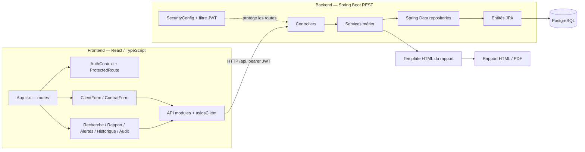

# Carte du code BIC

Carte d'architecture maintenue pour aider les développeurs et assistants IA à trouver les bons points d'entrée. Elle décrit les liens confirmés par l'organisation et les appels visibles dans le dépôt ; elle ne remplace pas la vérification du code source. Le graphe de symboles généré par Graphify se trouve dans `../graphify-out/`.

## Vue d'ensemble

## Parcours principaux

| Parcours | Points d'entrée et enchaînement |
|---|---|
| Connexion et session | `src/pages/LoginPage.tsx` → `src/api/authApi.ts` → `auth/AuthController` → `JwtUtil`, `JwtAuthenticationFilter`, `config/SecurityConfig` → `src/context/AuthContext.tsx` → `components/auth/ProtectedRoute.tsx` |
| Créer un client | Route `/demande/nouvelle/individu` dans `src/App.tsx` → `features/client/ClientForm.tsx` + `clientSchema.ts` → `api/clientApi.ts` → `client/ClientController` → `ClientService` → `ClientRepository` et entités client |
| Créer une demande | Route `/demande/nouvelle/contrat/:clientId` → `features/contrat/ContratForm.tsx` + `contratSchema.ts` → `api/contratApi.ts` → `contrat/ContratController` → `ContratService` → repositories et entités contrat/échéance |
| Consulter un rapport | Route `/demande/rapport/:contratId` → `pages/RapportPage.tsx` → `api/rapportApi.ts` → `rapport/RapportController` → `RapportService`, `ScoreService`, services calendrier/PDF → `resources/templates/rapport-solvabilite.html` |
| Fonctions transverses | Pages de recherche, rapports, alertes et audit → API frontend → contrôleurs `client`, `rapport` et `audit`; les alertes sont calculées depuis les contrats actifs et leurs échéances |

## Routes frontend

Les routes applicatives sont déclarées dans `bic-frontend/src/App.tsx`. `/login` est publique ; le reste passe par `ProtectedRoute`.

| Route | Page / formulaire |
|---|---|
| `/` | `HomeMenu` |
| `/demande/nouvelle/individu` | `ClientForm` |
| `/demande/nouvelle/contrat/:clientId` | `ContratForm` |
| `/demande/rapport/:contratId` | `RapportPage` |
| `/recherche/individu` | `RechercheIndividuPage` |
| `/demande/modifier` | `MiseAJourDemandePage` |
| `/alertes` | `AlertesPage` |
| `/rapports` | `HistoriqueRapportsPage` |
| `/audit` | `AuditPage` |

`axiosClient` prend `VITE_API_BASE_URL` ou utilise `http://localhost:8080/api` par défaut et ajoute le bearer token stocké côté navigateur.

## API backend repérées

| Contrôleur | Base de route | Responsabilité |
|---|---|---|
| `AuthController` | `/api/auth` | Connexion |
| `UtilisateurController` | `/api/utilisateurs` | Comptes utilisateurs |
| `ClientController` | `/api/clients` | Création, mise à jour, adresses et recherche client |
| `ContratController` | `/api/contrats` | Demandes, liste/recherche, historique admin et changement de phase |
| `EcheanceController` | `/api/echeances` | Échéances et paiements |
| `RapportController` | `/api/rapports/contrat/{contratId}` | Rapport JSON, HTML et PDF |
| `AlerteController` | `/api/alertes` | Alertes d'échéances en retard ou impayées |
| `AuditController` | `/api/audit` | Journal d'audit |

## Repères pour une question ciblée

- Formulaire et validation : commencer par le fichier de formulaire et son schéma Zod, puis suivre l'API appelée.
- Champ ou règle métier : rechercher le DTO et le service backend correspondants, puis confirmer l'entité et le mapping JPA.
- Rapport : commencer par `RapportController`, suivre `RapportService`, puis vérifier le DTO de réponse et le template HTML.
- Autorisation : vérifier `SecurityConfig`, le filtre JWT et les annotations `@PreAuthorize` du contrôleur.
- Configuration locale : `bic-backend/src/main/resources/application.yml`, `bic-frontend/vite.config.ts` et `bic-frontend/package.json`. Ne jamais recopier de valeurs sensibles dans cette documentation.

## Graphe Graphify et mise à jour

`../graphify-out/` contient le rapport lisible (`GRAPH_REPORT.md`), le graphe interrogeable (`graph.json`), le manifeste portable (`manifest.json`) et sa visualisation (`graph.html`). Le graphe a été construit en mode code uniquement : 154 fichiers analysés, 948 nœuds et 2 160 liens répartis en 59 communautés. Les deux scripts SQL de données n'ont pas de symboles extraits. Les documents et images ne sont pas inclus, car leur extraction demanderait un backend de modèle ; le cahier des charges reste donc à consulter séparément.

Après avoir installé le CLI Graphify (`uv tool install graphifyy`), depuis la racine du dépôt, actualiser avec `graphify . --code-only`, puis `graphify cluster-only .`. Les caches et métadonnées locales sont ignorés par `.gitignore`; les fichiers `graph.json`, `GRAPH_REPORT.md`, `graph.html` et `manifest.json` restent partageables. Si l'architecture ou les routes ont changé, actualiser aussi cette carte Mermaid et vérifier les liens dans le code.
